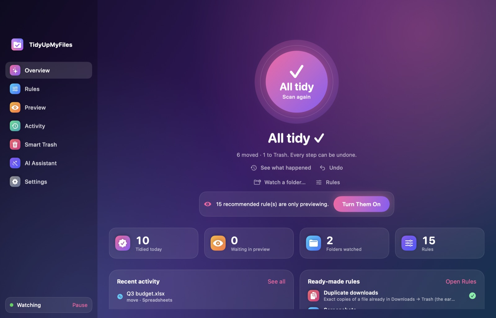
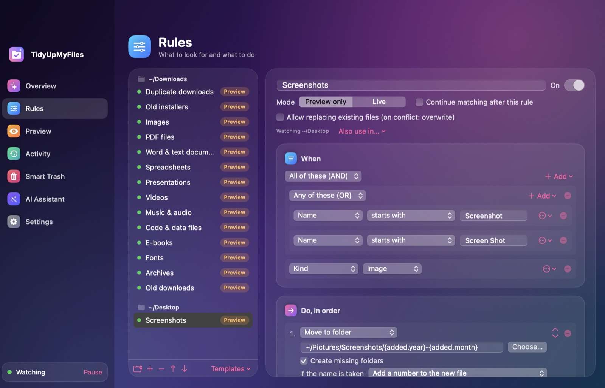
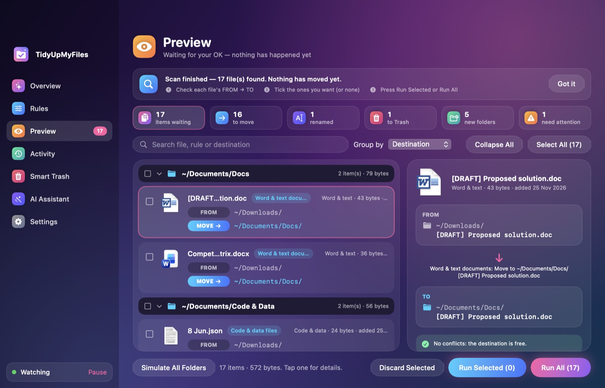
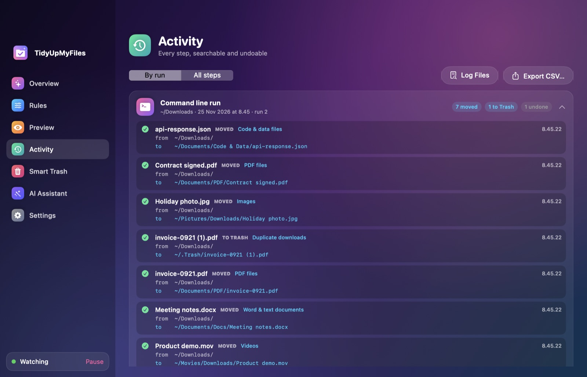
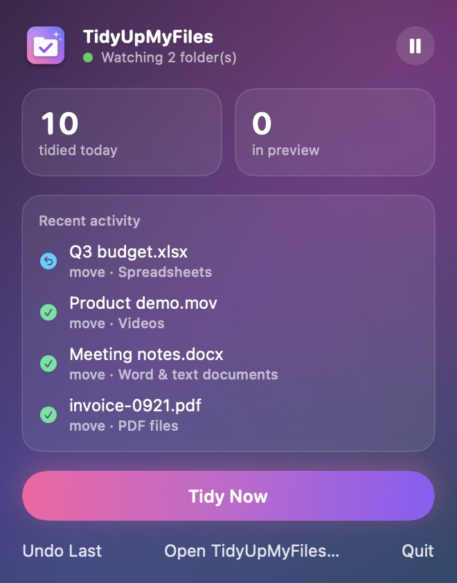

<div align="center">
  
  <h1>TidyUpMyFiles</h1>
  <p><b>Free, open-source file organizer for macOS. Automatically sorts your Downloads, Desktop and Documents with rules, from the menu bar.</b></p>
  <p>Preview every move · Undo anything · Works offline · No account, no telemetry</p>

  
  
  

  <p><a href="#install">Install</a> · <a href="docs/USER-GUIDE.md">User guide</a> · <a href="#build-from-source">Build from source</a></p>

  
</div>

TidyUpMyFiles is a **macOS menu bar app that organizes files automatically**. It watches your Downloads,
Desktop and Documents folders and sorts new files with simple rules: "screenshots go to
Pictures/Screenshots/2026-11", "installers older than a week go to the Trash", "PDFs go to Documents/PDF". You see every move before
it happens, nothing is ever deleted for good, and any step can be undone. Every feature is included: no
trial, no account, no telemetry. It works fully offline; AI suggestions are optional and off by default.

<table>
  <tr>
    <td></td>
    <td></td>
  </tr>
  <tr>
    <td align="center">Build rules visually, no code</td>
    <td align="center">See every move before anything runs</td>
  </tr>
  <tr>
    <td></td>
    <td></td>
  </tr>
  <tr>
    <td align="center">Every step logged, one-click Undo</td>
    <td align="center">Lives in the menu bar</td>
  </tr>
</table>

## Install

1. Download **TidyUpMyFiles-x.y.z.dmg** from the [latest release](../../releases/latest), open it and drag
   the app to **Applications**. It lives in the menu bar and the Dock.
2. The app isn't notarized by Apple yet, so the first time you open it macOS says it "could not verify" it.
   Click **Done**, then go to **System Settings → Privacy & Security** and click **Open Anyway**. Or run
   `xattr -dr com.apple.quarantine /Applications/TidyUpMyFiles.app`.
3. Allow access to Desktop, Documents and Downloads when macOS asks. Full Disk Access is only needed for
   Smart Trash.

With Homebrew: `brew install --cask k0wl0n/tap/tidyupmyfiles` for the app, or `brew install k0wl0n/tap/tidyup`
for just the [command line](docs/CLI.md) tool (it's also inside the app).

To check a download, compare it with the release's `checksums.txt` (`shasum -a 256 -c checksums.txt`) and
confirm it was built by this repository's release workflow:
`gh attestation verify TidyUpMyFiles-x.y.z.dmg --repo k0wl0n/TidyUpMyFiles`.
Prefer to build it yourself? See [Build from source](#build-from-source).

## Features

- **Rules per folder** with nested **AND / OR / NOT** conditions: name, extension, kind, size, dates,
  photo date, Finder tags and colors, download source, text inside the file, duplicates.
- **Actions in order**: move, copy, rename with tokens like `{added.year}`, tag, color, zip, unzip,
  alias, Shortcuts, Trash, open, and opt-in shell scripts.
- **Ready-made rules** for screenshots, PDFs, documents, spreadsheets, videos, music, installers,
  duplicates and more — add each to any folder you like.
- **Preview first**: new rules only list what they would do until you switch them to **Live**.
- **See every move**: Preview shows each file's from → to with the exact new name, name clashes and new folders.
- **Safe name clashes**: add a number, rename the existing file, skip, or replace only when you allow it.
- **Real-time watching** that waits until downloads have finished.
- **Never deletes**: removed files go to the Trash, and every step can be undone, one file or a whole run.
- **Hands off the system**: system folders, `~/Library`, `.git` folders and apps are never touched.
- **Activity log** grouped by run, readable monthly log files and CSV export.
- **Notifications with Undo** after background tidying (optional).
- **Smart Trash** empties items that sat in the Trash too long, after showing you what would go.
- **Optional AI suggestions**: a local model or your own key; only names are shared by default and
  every suggestion waits for your approval.
- **YAML import/export** of your rules ([reference](docs/RULES.md)) and a **`tidyup` command** ([CLI](docs/CLI.md)).
- **Works with AI agents** over MCP: Claude Code, Claude Desktop, Cursor or Codex can simulate, tidy and
  undo with the same safety rules ([setup](docs/MCP.md)).

## How it works

1. **Scan** — the big button on the Overview looks through your folders. Nothing moves.
2. **Preview** — **See results** shows where every file would go. Tick what you want.
3. **Tidy** — **Run Selected** or **Run All**. Rules you switch to **Live** then keep tidying new files by themselves.
4. **Undo** — every run is in Activity; **Undo** puts everything back.

## Build from source

Requirements: macOS 13 or later to run; Xcode 16 or later (Swift 5.9+) to build.

```sh
swift build                 # debug build
swift test                  # tests (temporary folders only)
./scripts/build-app.sh      # universal TidyUpMyFiles.app and tidyup in ./build
```

Dependencies are pinned exactly in `Package.resolved` (Yams 6.2.2); CI builds with
`--only-use-versions-from-resolved-file`, and Dependabot waits 7 days before proposing updates.

Make the release files (DMG, command line archive and `checksums.txt`) the same way the release workflow does:

```sh
VERSION=1.2.0 ./scripts/build-app.sh && VERSION=1.2.0 ./scripts/make-dmg.sh
```

With an Apple Developer ID, set `SIGN_IDENTITY="Developer ID Application: Your Name (TEAMID)"` for both scripts
and `NOTARY_PROFILE=notary` for `make-dmg.sh` to sign, notarize and staple the DMG (create the profile once with
`xcrun notarytool store-credentials notary`).

## User guide

- [User guide](docs/USER-GUIDE.md) — every screen with a picture and how to use it, including switching rules to Live.
- [Rules reference](docs/RULES.md) — the `rules.yaml` format, every condition, action and name token.
- [Command line](docs/CLI.md) — `tidyup sim`, `run`, `undo`, `log`, `templates`.
- [AI agents (MCP)](docs/MCP.md) — connect Claude Code, Claude Desktop, Cursor or Codex.
- [Architecture](docs/ARCHITECTURE.md) — how it works inside, the safety model, where things are stored and permissions.

## FAQ

**How do I automatically organize my Downloads folder on a Mac?**
Install TidyUpMyFiles, press **Scan** on the Overview screen, check the Preview and press **Tidy**. The
ready-made rules sort images, PDFs, documents, spreadsheets, videos, music, archives and installers into
their own folders, and new downloads are sorted as they arrive.

**Is it a free alternative to Hazel?**
It works in a similar way (folder rules with conditions and actions) and is free and open source under the
MIT license, with a visual rule editor, a preview of every move and undo for every step.

**Can it delete my files?**
No. Files only ever go to the Trash, never deleted permanently, and every move, rename or trash can be
undone from the Activity log. New rules start in preview mode, and system folders, `~/Library`, `.git`
folders and apps are never touched.

**Does it need the internet or send my data anywhere?**
No. It works fully offline with no account and no telemetry. AI rule suggestions are optional, off by
default, and can run locally with Ollama.

**Can I use it from the command line or an AI agent?**
Yes. The `tidyup` command runs the same rules ([CLI guide](docs/CLI.md)), and `tidyup mcp` lets AI agents
such as Claude preview, tidy and undo ([MCP guide](docs/MCP.md)).

**Which macOS versions are supported?**
macOS 13 Ventura or later, on Apple Silicon and Intel Macs.

## Contributing

Issues and pull requests are welcome — see [CONTRIBUTING.md](CONTRIBUTING.md). Coding agents start from
[AGENTS.md](AGENTS.md) (Claude Code reads [CLAUDE.md](CLAUDE.md)), with project skills in
[.claude/skills](.claude/skills/README.md). Please report safety
problems privately as described in [SECURITY.md](SECURITY.md). Changes are listed in [CHANGELOG.md](CHANGELOG.md).

## License

MIT, see [LICENSE](LICENSE). Third-party licenses: [THIRD_PARTY_NOTICES.md](THIRD_PARTY_NOTICES.md).
