# TidyUpMyFiles — user guide

The pictures come from a demo setup with sample files, so they show made-up names and folders.

## Your Mac, tidy by itself

- Free and open source (MIT): every feature included — no trial, no account, no telemetry.
- Rules sort new files the moment they arrive; you always see what will happen first.
- Nothing is ever deleted for good, and every step can be undone.

## Overview

- One breathing button leads the way: **Scan** looks first and moves nothing.
- Then it shows where files would go and becomes **See results**, which opens Preview with a short guide.
- Afterwards: **All tidy ✓** with **See what happened** and **Undo**. Hover anything for a tip.

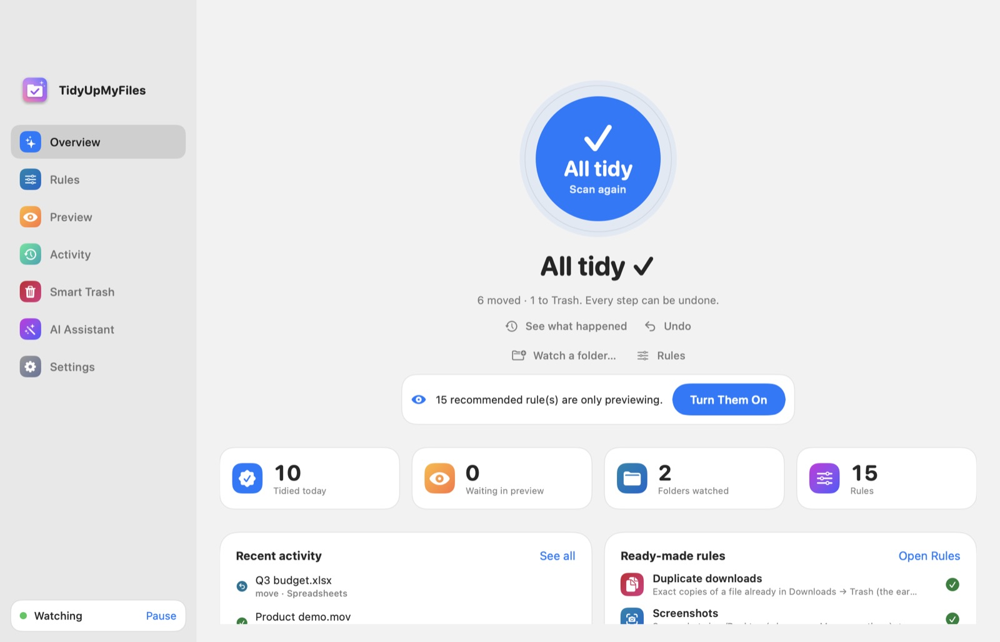

## Ready-made rules

- Pick a template — screenshots, spreadsheets, videos, duplicates, old installers and more.
- Add to any folder with **Add to** — each card shows which folders already use it.
- Everything a rule doesn't recognise is archived by month only after 30 days.

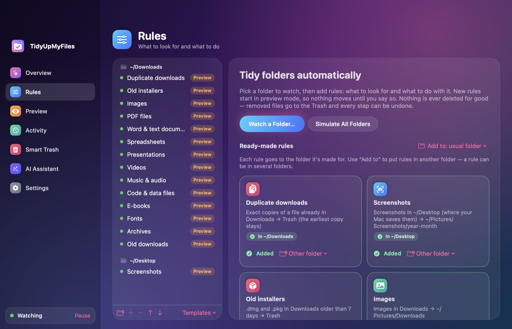

## The same rule in many folders

- Select a folder to see every ready-made rule for it: **Add to ~/Desktop**, or **Added here**.
- A green chip shows where a rule is already used, e.g. “In ~/Downloads”.
- **More** adds it to any other folder, even one you don't watch yet.

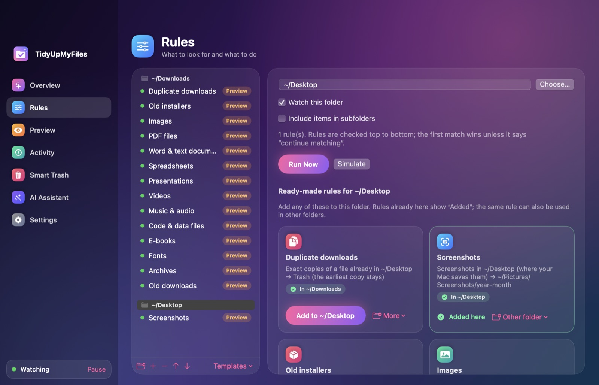

## Build your own rule — no code

- Combine conditions with **All of these (AND)**, **Any of these (OR)** and **NOT**, nested freely.
- Name, extension, kind, size, dates, photo date, text inside, duplicates, tags, download source…
- Actions run in order: move, copy, rename with tokens like `{added.year}`, zip, tag, Trash.


## Turn a rule on: Preview → Live

- New rules start in **Preview only**: they list what they would do and wait for you in Preview.
- When the preview looks right, open the rule and set **Mode** to **Live**. From then on it tidies new files by itself, and **Run Now** on the folder handles what's already there.
- Ready-made rules: on the Overview, **Turn Them On** switches every one that is still previewing to Live in one go.
- Live really moves files — each step shows in Activity, and **Undo** puts it back. Set Mode back to Preview only (or the switch to Off) to stop a rule.

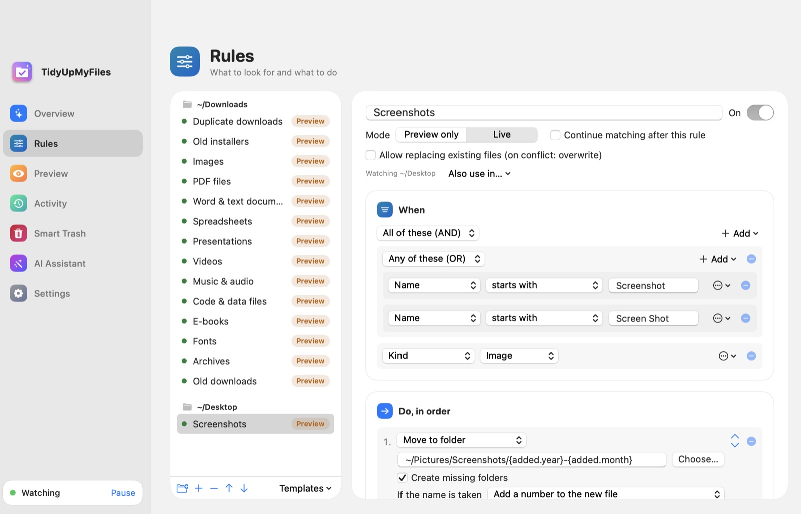

## Preview: see every move first

- Each item shows **FROM** → action → **TO** with the exact final file name.
- Click an item for the full paths and a plain-language explanation on the right.
- Tick items and press **Run Selected**, or **Run All**.

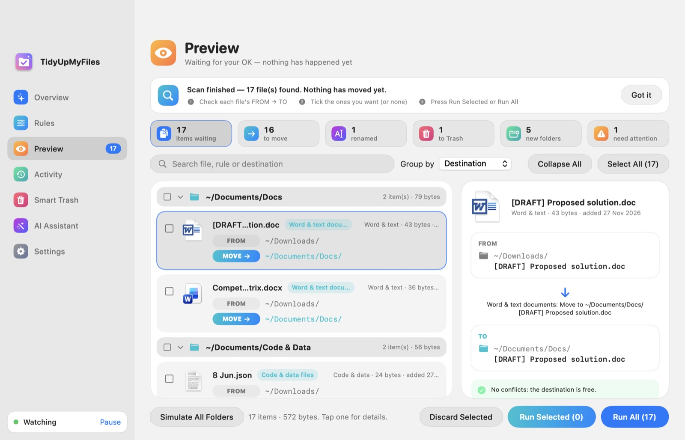

## Name clashes are caught before they happen

- **Need attention** filters items whose destination name is taken.
- You see the new name it will get (here “… 2.xlsx”) — nothing is overwritten.
- Replacing a file needs explicit permission in the rule, and the old one goes to the Trash.

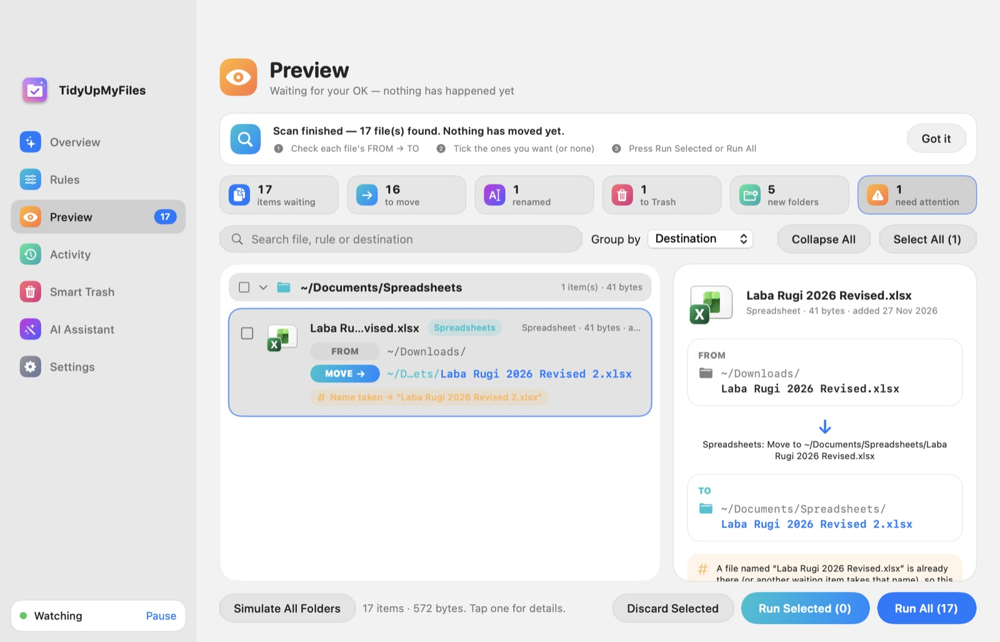

## Big lists, folded

- Group by destination, rule or current folder.
- Click a group header to fold or unfold it; **Collapse All / Expand All** does every group.
- Lists over 30 items open folded: first the overview, then the details you care about.

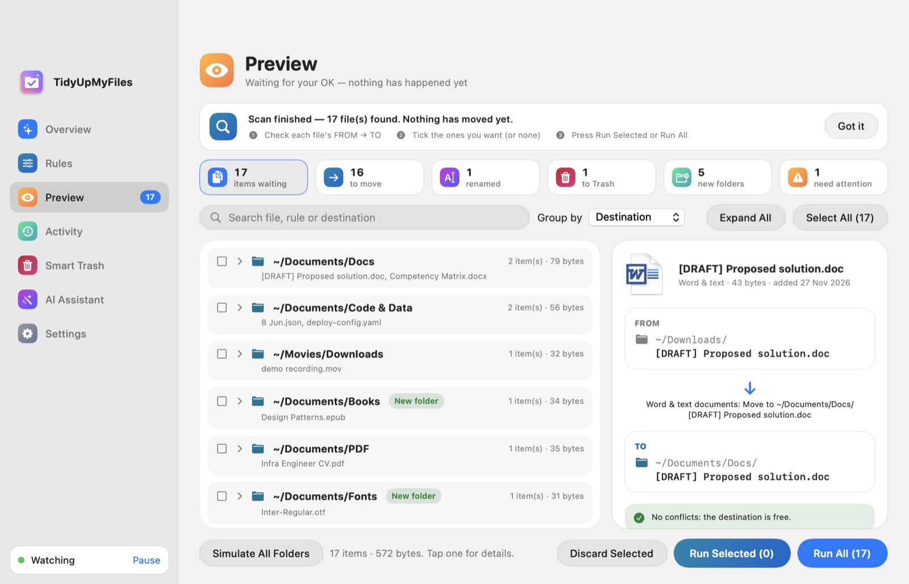

## Always clear when it's busy

- Scans show what's running, which folder, how far it is and the current file.
- **Cancel** stops after the current item — steps already done stay undoable.
- Slow checks (Spotlight, file contents, duplicates) only run when a rule needs them.

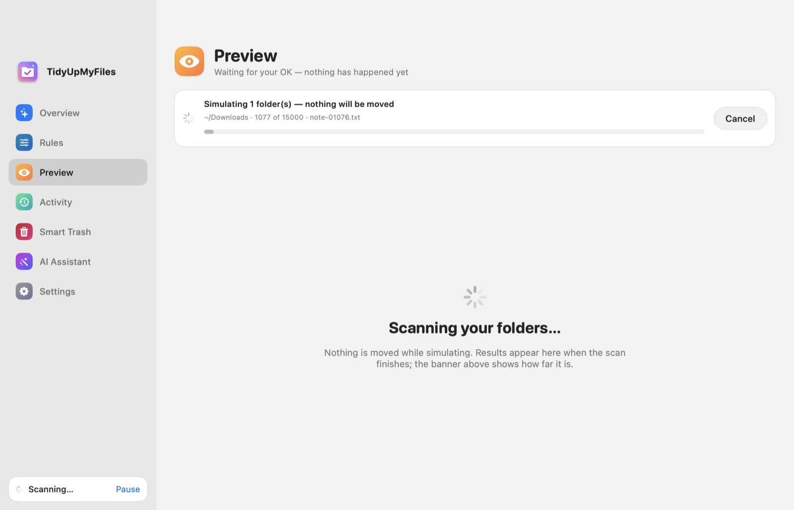

## Activity: what happened to each file

- Every run is a card: what started it, when, and how many files moved, were skipped or failed.
- Open a run to see each file's from → to, or why it was skipped.
- **Undo This Run** puts everything back.

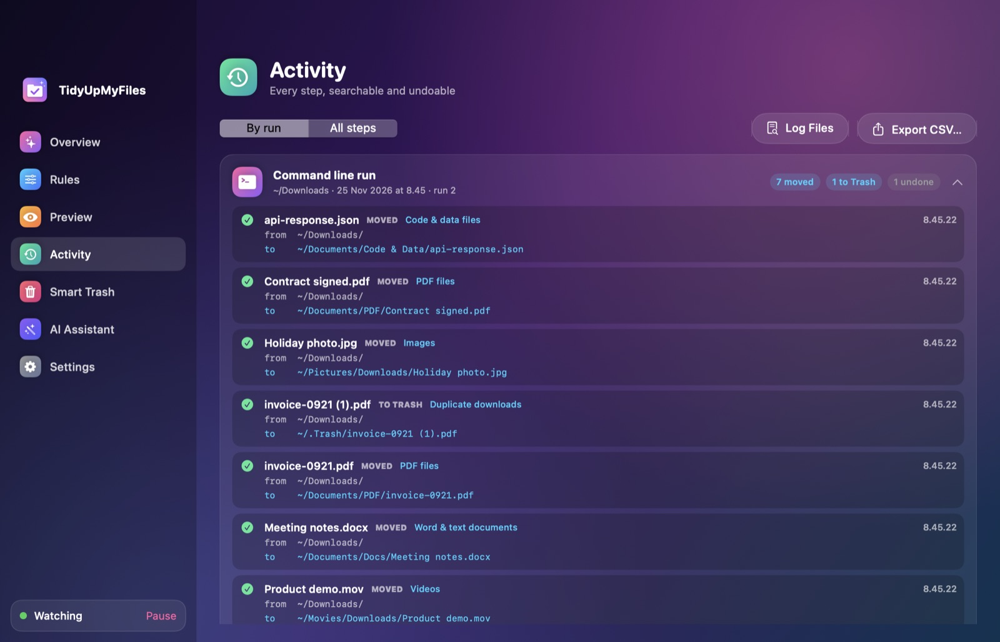

## Every step — plus a log file

- **All steps** lists everything with search and filters; **Export CSV…** for spreadsheets.
- **Log Files** opens readable monthly logs in ~/Library/Logs/TidyUpMyFiles.
- Background tidying can send a notification (Settings).

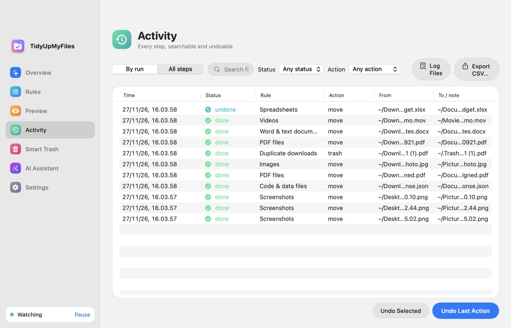

```
2026-11-27 16:11:21  DONE     MOVE         ~/Desktop/Screenshot 2026-11-20 at 09.15.02.png → ~/Pictures/Screenshots/2026-11/Screenshot 2026-11-20 at 09.15.02.png  · Screenshots · run 1 (cli)
2026-11-27 16:11:21  DONE     MOVE         ~/Desktop/Screenshot 2026-11-21 at 14.02.44.png → ~/Pictures/Screenshots/2026-11/Screenshot 2026-11-21 at 14.02.44.png  · Screenshots · run 1 (cli)
2026-11-27 16:11:21  DONE     MOVE         ~/Desktop/Screenshot 2026-11-23 at 18.40.10.png → ~/Pictures/Screenshots/2026-11/Screenshot 2026-11-23 at 18.40.10.png  · Screenshots · run 1 (cli)
2026-11-27 16:11:22  DONE     MOVE         ~/Downloads/api-response.json → ~/Documents/Code & Data/api-response.json  · Code & data files · run 2 (cli)
2026-11-27 16:11:22  DONE     MOVE         ~/Downloads/Contract signed.pdf → ~/Documents/PDF/Contract signed.pdf  · PDF files · run 2 (cli)
2026-11-27 16:11:22  DONE     MOVE         ~/Downloads/Holiday photo.jpg → ~/Pictures/Downloads/Holiday photo.jpg  · Images · run 2 (cli)
2026-11-27 16:11:22  DONE     TRASH        ~/Downloads/invoice-0921 (1).pdf → ~/.Trash/invoice-0921 (1).pdf  · Duplicate downloads · run 2 (cli)
2026-11-27 16:11:22  DONE     MOVE         ~/Downloads/invoice-0921.pdf → ~/Documents/PDF/invoice-0921.pdf  · PDF files · run 2 (cli)
2026-11-27 16:11:22  DONE     MOVE         ~/Downloads/Meeting notes.docx → ~/Documents/Docs/Meeting notes.docx  · Word & text documents · run 2 (cli)
2026-11-27 16:11:22  DONE     MOVE         ~/Downloads/Product demo.mov → ~/Movies/Downloads/Product demo.mov  · Videos · run 2 (cli)
2026-11-27 16:11:22  DONE     MOVE         ~/Downloads/Q3 budget.xlsx → ~/Documents/Spreadsheets/Q3 budget.xlsx  · Spreadsheets · run 2 (cli)
2026-11-27 16:11:23  UNDONE   MOVE         ~/Downloads/Q3 budget.xlsx → ~/Documents/Spreadsheets/Q3 budget.xlsx  · Spreadsheets · run 2 (undo)
```

## Smart Trash

- Optionally empties items that have been in the Trash for over 30 days, with an optional size cap.
- **Check Trash** shows exactly what would go; automatic emptying waits for your OK once.
- Here the demo Trash only holds a file trashed minutes ago, so nothing qualifies yet.

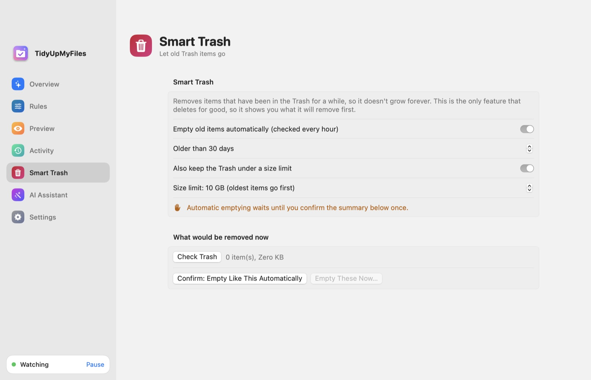

## AI Assistant — optional, private by default

- Off by default. Local Ollama first; or bring your own OpenAI-compatible, Anthropic or Gemini key.
- Only folders you allow; only names and details are sent unless you opt in to text.
- Suggestions wait for **Approve**; **Make This a Rule** keeps a good idea.

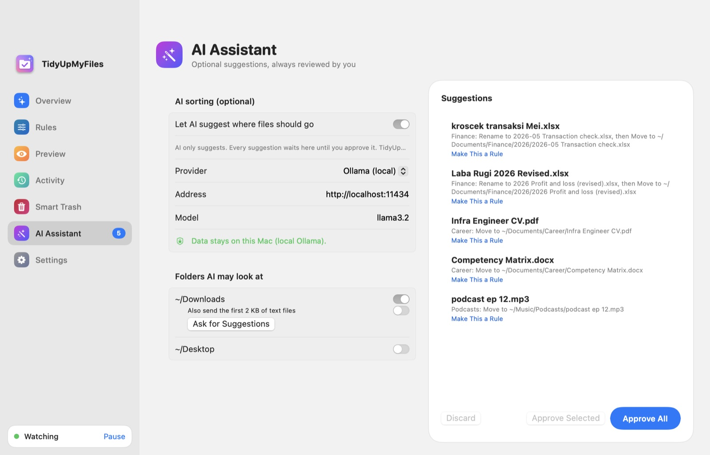

## Settings

- Pause watching, launch at login, and how long a file must be still before it's touched.
- Shell-script actions stay off unless you turn them on.
- Import and export your rules as YAML — easy to back up or keep in git.

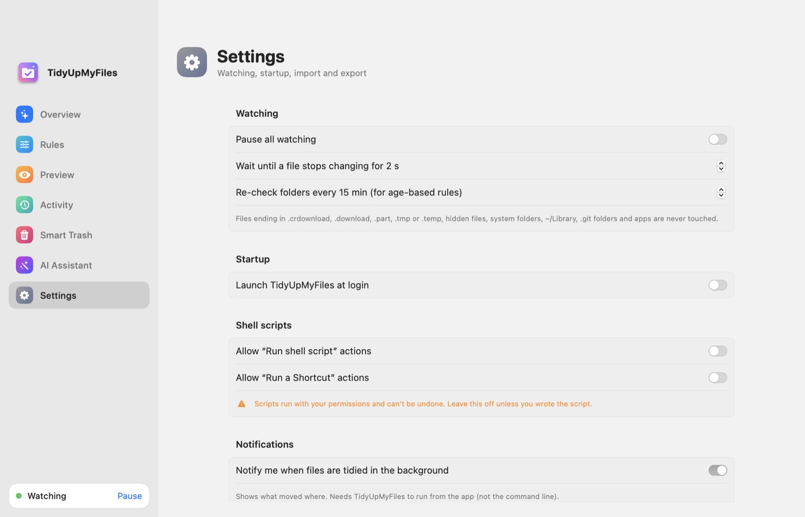

## Menu bar

- Status, files tidied today and recent activity at a glance.
- **Tidy Now**, **Undo Last**, Pause, and open the main window.
- If the menu bar icon is hidden, the app is also in the Dock.

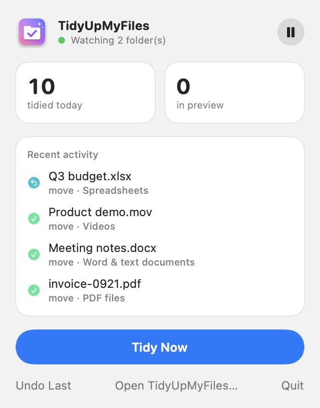

## Command line

- `tidyup templates add` sets up the recommended rules.
- `tidyup sim` shows what would happen; `tidyup run` does it; `tidyup undo` takes it back.
- Same rules file and history as the app.

```
$ tidyup templates
[✓] duplicates      Exact copies of a file already in Downloads → Trash (the earliest copy stays)
[✓] screenshots     Screenshots in ~/Desktop (where your Mac saves them) → ~/Pictures/Screenshots/year-month
[✓] old-installers  .dmg and .pkg in Downloads older than 7 days → Trash
[✓] images          Images in Downloads → ~/Pictures/Downloads
[✓] pdf             PDFs in Downloads → ~/Documents/PDF
[✓] documents       Word & text files in Downloads → ~/Documents/Docs
[✓] spreadsheets    Spreadsheet files in Downloads → ~/Documents/Spreadsheets
[✓] presentations   Presentation files in Downloads → ~/Documents/Presentations
[✓] videos          Video files in Downloads → ~/Movies/Downloads
[✓] audio           Audio files in Downloads → ~/Music/Downloads
[✓] code            Code & data files in Downloads → ~/Documents/Code & Data
[✓] ebooks          E-book files in Downloads → ~/Documents/Books
[✓] fonts           Font files in Downloads → ~/Documents/Fonts
[✓] archives        .zip, .tar.gz and .7z in Downloads → ~/Downloads/Archives
[✓] old-downloads   Files nothing above recognises, older than 30 days → ~/Archive/Downloads/year-month

$ tidyup sim ~/Downloads
```

## Safe by design

- New rules start in preview: nothing moves until you say so.
- Never deletes for good — removed files go to the Trash; every step can be undone.
- Never touches system folders, ~/Library, .git folders or apps. Works fully offline.
